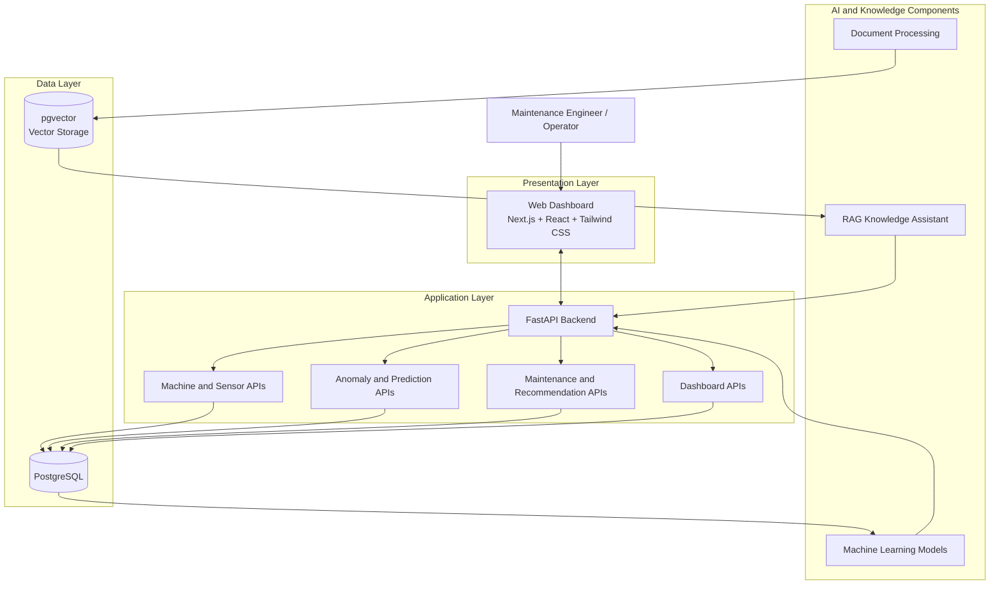
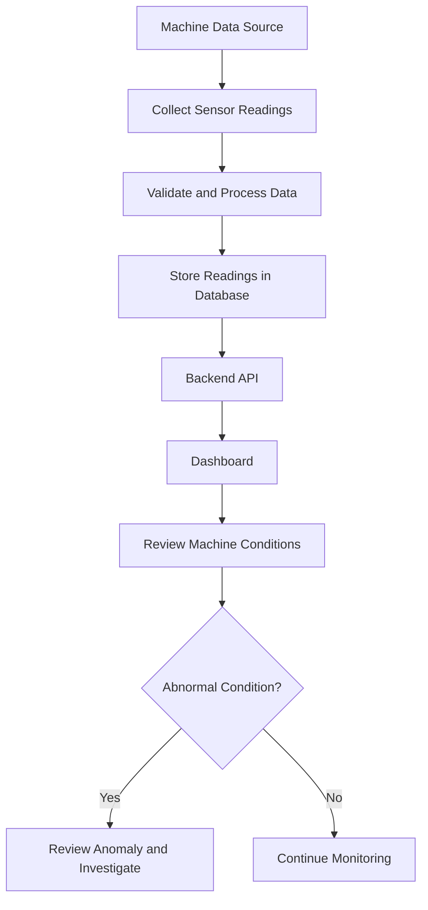
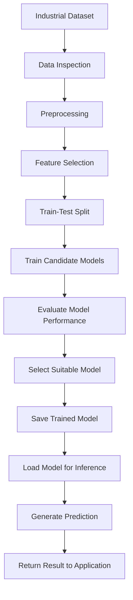
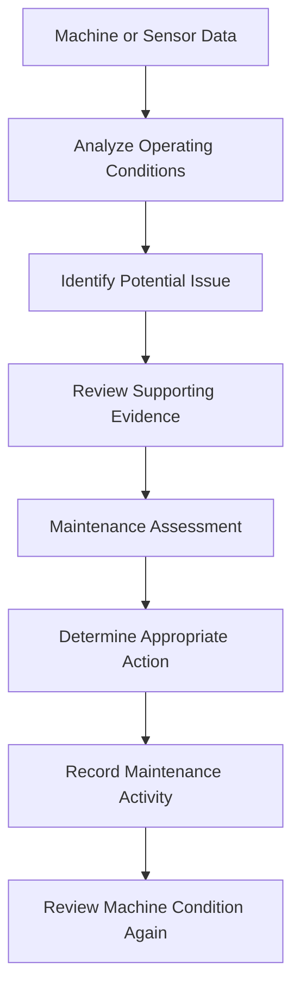
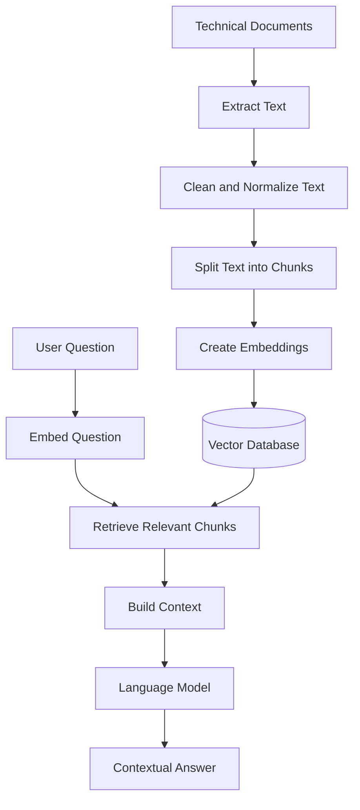
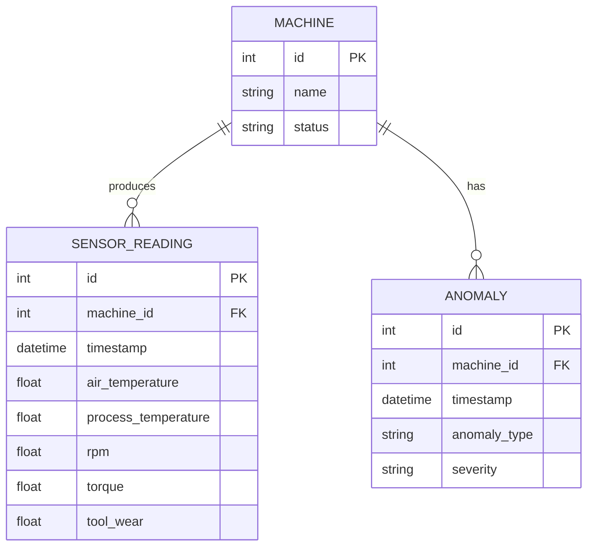

# Industrial AI Maintenance System

**AI-Powered Predictive Maintenance and Industrial Process Monitoring**

An intelligent industrial maintenance platform designed to monitor machine conditions, identify potential failures, organize maintenance information, and support data-driven maintenance decisions.

---

## Table of Contents

- [Overview](#overview)
- [Problem Statement](#problem-statement)
- [Project Objectives](#project-objectives)
- [Key Capabilities](#key-capabilities)
- [System Architecture](#system-architecture)
- [Technology Stack](#technology-stack)
- [System Workflows](#system-workflows)
- [AI and Machine Learning](#ai-and-machine-learning)
- [Database Design](#database-design)
- [Project Structure](#project-structure)
- [Getting Started](#getting-started)
- [Use Cases](#use-cases)
- [Current Implementation Status](#current-implementation-status)
- [Future Enhancements](#future-enhancements)
- [Contributing](#contributing)
- [License](#license)

---

## Overview

Industrial AI Maintenance System is a software platform focused on making industrial equipment monitoring and maintenance more intelligent and efficient.

Traditional maintenance practices often depend on fixed maintenance schedules or manual inspection. These approaches can lead to unnecessary servicing, delayed fault detection, unexpected equipment downtime, and increased operational costs.

This project aims to use machine sensor data, machine learning, and an integrated monitoring interface to help maintenance teams understand machine conditions, identify potential anomalies, and make better maintenance decisions.

The platform combines a web-based dashboard, a backend API, a relational database, and AI-powered analysis components. Additional document-processing and retrieval-augmented generation (RAG) capabilities are being explored to make maintenance documentation and technical knowledge easier to access.

## Problem Statement

Industrial equipment can experience abnormal operating conditions before a failure occurs. Without timely monitoring and useful analysis, these conditions may remain undetected until they affect production.

Common challenges include:

- Unexpected machine failures and production downtime.
- Difficulty monitoring multiple machines from one interface.
- Limited visibility into sensor readings and equipment health.
- Time-consuming identification of abnormal operating patterns.
- Maintenance information scattered across technical documents and records.
- Inefficient maintenance planning and troubleshooting.

### Proposed Solution

The system provides a centralized platform for equipment monitoring and maintenance analysis. It is designed to organize machine and sensor data, apply analytical and machine learning techniques, and present useful information through a dashboard and API.

---

## Project Objectives

1. Centralize machine, sensor, anomaly, and maintenance information.
2. Provide a dashboard for monitoring industrial equipment.
3. Use machine learning to classify or identify potentially abnormal machine activity.
4. Support failure analysis and maintenance decision-making.
5. Provide structured APIs for communication between the frontend and backend.
6. Explore AI-assisted retrieval of relevant technical documentation.
7. Build a modular and extensible architecture that can later support real industrial telemetry.

---

## Key Capabilities

| Component | Purpose |
|---|---|
| Machine Monitoring | Organize machine information and equipment status. |
| Sensor Data Management | Store and retrieve readings such as temperature, rotational speed, torque, and tool wear. |
| Anomaly Management | Record and review detected or labeled abnormal events. |
| Predictive Analysis | Apply machine learning to support failure-related analysis. |
| Maintenance Management | Organize maintenance-related information and activities. |
| Recommendations | Provide a foundation for maintenance guidance and recommended actions. |
| Dashboard | Present machine status, readings, anomalies, and analytical summaries. |
| AI Knowledge Assistant | Explore retrieval of relevant information from technical documents. |

*Availability and integration of individual capabilities depend on the current implementation status described below.*

---

## System Architecture

The application follows a modular architecture in which the user interface communicates with backend APIs, the backend manages application logic and database access, and AI components provide analytical capabilities.



**Architecture notes**

- **Frontend:** Presents machine information, sensor data, alerts, and maintenance-related views.
- **Backend:** Exposes API endpoints and coordinates application operations.
- **PostgreSQL:** Stores structured application data.
- **Machine learning:** Supports data-driven analysis and predictions.
- **Vector search and RAG:** Provide a potential path for retrieving relevant maintenance knowledge from documents.

The diagram represents the intended high-level architecture. It does not imply that every connection shown is already fully integrated or verified.

---

## Technology Stack

| Technology | Role |
|---|---|
| Next.js | Web application framework |
| React | Interactive user interface |
| Tailwind CSS | UI styling and responsive layouts |
| Python | Backend and AI/ML development |
| FastAPI | REST API development |
| PostgreSQL | Relational database |
| pgvector | Vector similarity search support |
| Pandas and NumPy | Data manipulation and numerical processing |
| Scikit-learn | Machine learning and model evaluation |
| Joblib | Saving and loading trained models |
| Streamlit | Prototype interface for the RAG assistant |
| ChromaDB | Vector database used by the RAG prototype |
| OpenRouter API | Access to language models for the RAG prototype |
| Docker | Local development services and database deployment |
| Git and GitHub | Version control and collaboration |

*The table includes technologies used across the application and its AI prototypes; it is not a claim that all of them are deployed together in production.*

---

## System Workflows

### 1. Machine Monitoring Workflow



This workflow illustrates how machine readings can move from a data source to the database and dashboard. Live sensor collection depends on connecting an actual telemetry source.

### 2. AI/ML Analysis Workflow



The machine learning workflow separates training and evaluation from inference. A prediction should be interpreted according to the target label and the limitations of the dataset.

### 3. Maintenance Decision Workflow



This workflow describes the intended decision-support process. AI-generated results should assist qualified personnel rather than automatically replace engineering judgment.

### 4. AI Knowledge Assistant Workflow



The RAG workflow is intended to help users retrieve information from maintenance manuals, technical documentation, and other relevant project documents. Its availability depends on successful configuration and integration of the document-processing and retrieval components.

---

## AI and Machine Learning

The project explores machine learning as a way to analyze industrial operating data and support maintenance decisions.

### Dataset

The current development work uses the AI4I 2020 Predictive Maintenance dataset as a reference for industrial sensor and failure data.

The dataset contains 10,000 records and includes operating measurements and machine-failure labels.

The project also includes an importer that maps dataset records to simulated machines for local development and database testing.

**Important:** These records are dataset-derived and assigned to simulated machines. They are not live readings from physical industrial equipment.

### Model Development Pipeline

1. Inspect the dataset and understand its features.
2. Clean and prepare the data.
3. Select relevant features and the prediction target.
4. Split the data into training and testing sets.
5. Train multiple candidate models.
6. Compare evaluation metrics.
7. Save the selected model.
8. Load the model for predictions through an application interface.

### Evaluation

Candidate models should be compared using appropriate metrics such as:

- Accuracy
- Precision
- Recall
- F1-score
- Confusion matrix

For maintenance applications, recall for failure-related classes is particularly important because missed failures can be costly. Model performance should also be evaluated against class imbalance and the consequences of false alarms.

---

## Database Design

PostgreSQL serves as the relational storage layer for structured application data.

The core database entities include:

| Entity | Description |
|---|---|
| Machine | Identifies equipment and stores machine-related information. |
| SensorReading | Stores machine measurements and reading timestamps. |
| Anomaly | Stores information about identified or recorded abnormal events. |

Additional backend modules address predictions, maintenance, recommendations, and dashboard data.

A conceptual relationship between the core entities is shown below:



This is a conceptual illustration; actual table names, columns, constraints, and relationships should be verified against the current database models and migrations.

---

## Project Structure

The following is a high-level representation of the project organization. Exact paths may vary as the application evolves.

```text
industrial-ai/
├── frontend/                 # Web dashboard
├── backend/                  # FastAPI application and API routers
├── database/                 # Database utilities and data importers
├── data/                     # Development datasets
├── models/                   # Trained model artifacts, if maintained here
├── rag/                      # RAG assistant prototype
├── .env                      # Local environment variables (not committed)
├── .gitignore
└── README.md
```

Keep datasets, model artifacts, secrets, and generated vector database files out of version control when they are large, sensitive, or reproducible. Document any required external files and how to generate them.

---

## Getting Started

### Prerequisites

Install or configure the tools required by the components you intend to run:

- Git
- Node.js and npm
- Python
- PostgreSQL, or the project's configured Docker database service
- The Python and JavaScript dependencies listed in the relevant requirements files

### 1. Clone the Repository

```bash
git clone <repository-url>
cd industrial-ai
```

Replace `<repository-url>` with the actual GitHub repository URL.

### 2. Configure Environment Variables

Create a local `.env` file using the variable names expected by the backend and database configuration.

For example:

```env
DATABASE_URL=postgresql://<username>:<password>@localhost:<port>/<database>
```

Use the actual database port and credentials configured for your environment. Do not commit `.env` or expose API keys in source code.

### 3. Set Up the Backend

Navigate to the backend directory and install the dependencies listed in its requirements file.

```bash
cd backend
python -m venv .venv
```

Activate the virtual environment.

Windows PowerShell:

```powershell
.\.venv\Scripts\Activate.ps1
```

Then install dependencies:

```bash
pip install -r requirements.txt
```

Run the FastAPI application using the entry point and command configured in the repository. For example, if the entry point is `main.py`:

```bash
uvicorn main:app --reload
```

### 4. Set Up the Frontend

Open a separate terminal, navigate to the frontend directory, and install dependencies:

```bash
npm install
```

Start the development server using the script configured in `package.json`:

```bash
npm run dev
```

### 5. Run the AI or RAG Components

Follow the setup instructions and dependency files provided in the relevant AI or RAG directories. Some components may require datasets, trained model files, document-processing dependencies, or external API credentials.

**Note:** The commands above are a setup template. Verify the actual directory names, entry points, environment variable names, database migrations, and startup commands before treating this section as a tested installation guide.

---

## Use Cases

- **Manufacturing facilities:** Monitor equipment data and review potential abnormal conditions.
- **Maintenance teams:** Organize machine-related issues and maintenance information.
- **Industrial engineers:** Explore operating data to understand possible failure patterns.
- **Technical support teams:** Retrieve relevant information from maintenance documentation.
- **Students and researchers:** Experiment with industrial datasets, machine learning, and predictive maintenance architectures.

---

## Current Implementation Status

The project is under active development. Components should be described according to their actual integration status.

| Component | Status |
|---|---|
| Industrial dataset preparation and database importer | Implemented for local development |
| Simulated machine and sensor records | Imported and verified locally |
| Web dashboard | Developed; integration should be verified |
| FastAPI route modules | Present; end-to-end behavior requires verification |
| PostgreSQL and pgvector environment | Configured for development; complete schema initialization should be verified |
| Saved activity-classification model | Trained and saved for the IntelliHandover project; separate from this project's industrial failure model |
| Industrial failure prediction | Requires confirmation of the final trained model and inference integration |
| RAG assistant | Prototype available; production integration is not yet confirmed |
| Live industrial sensor integration | Future integration |

The activity-classification model from the separate IntelliHandover project is not an industrial machine-failure model and should not be presented as one.

---

## Future Enhancements

- Integrate real-time sensor streams from industrial equipment.
- Develop and validate machine-failure prediction models using appropriate industrial labels.
- Add alerting for abnormal operating conditions.
- Build maintenance scheduling and work-order management.
- Integrate explainable AI to communicate why a prediction was generated.
- Complete RAG integration for technical manuals and troubleshooting documentation.
- Add authentication, authorization, audit logs, and role-based access.
- Monitor model performance and data drift.
- Deploy the application with automated testing and CI/CD.
- Evaluate the system using real-world telemetry and operational feedback.

---

## Contributing

Contributions should follow the project's Git workflow:

1. Create a separate branch for a feature or fix.
2. Make focused changes and test them locally.
3. Commit changes with clear messages.
4. Push the branch to GitHub.
5. Open a pull request for review and integration.

Avoid committing credentials, unnecessary generated files, local database contents, or large model artifacts.

---

## License

A license has not yet been specified. Add a suitable license after the project team agrees on the terms under which the source code may be used, modified, and distributed.
